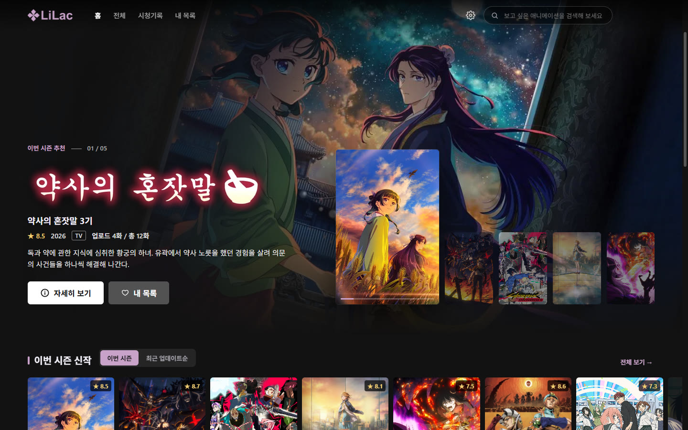
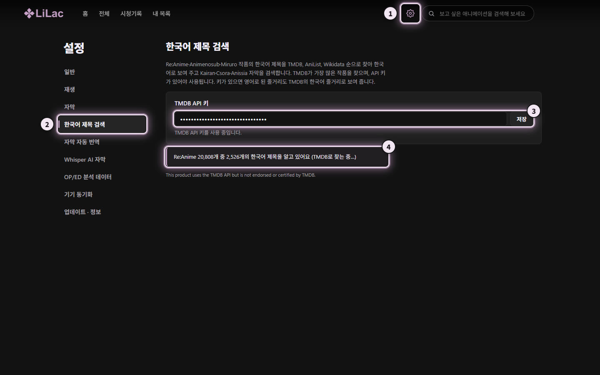
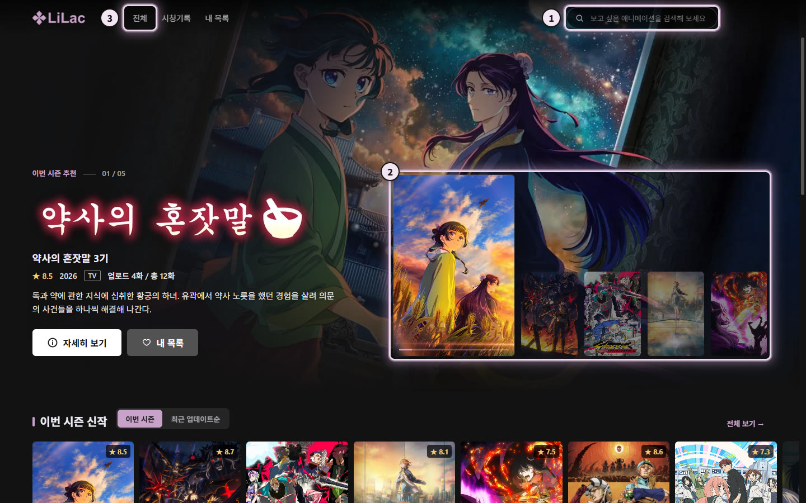
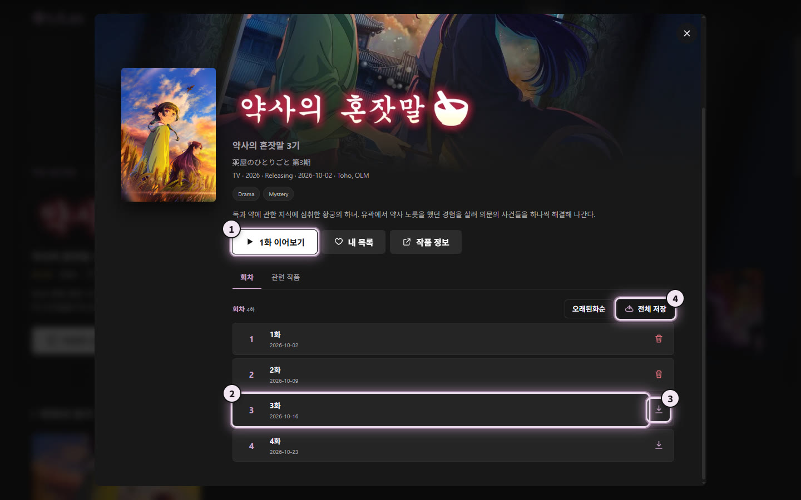
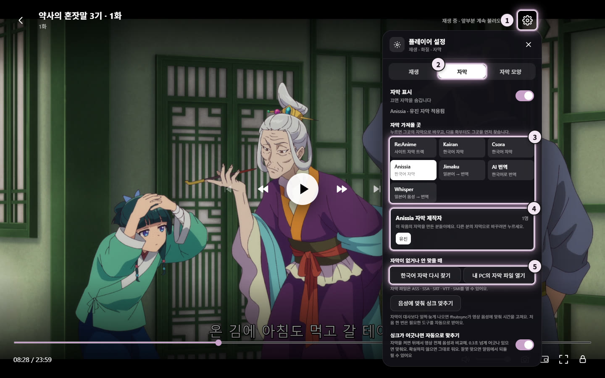
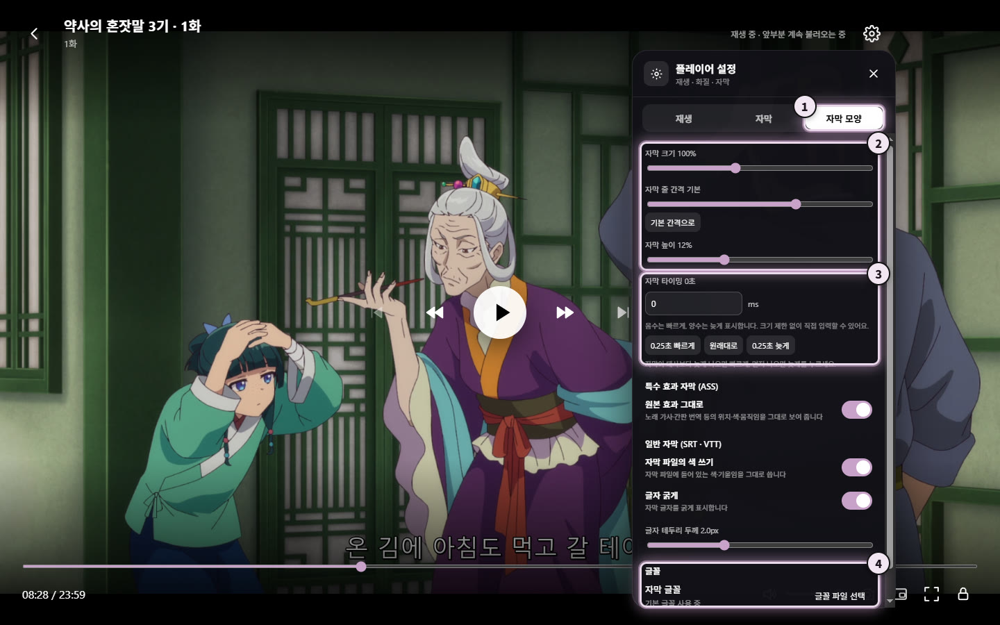
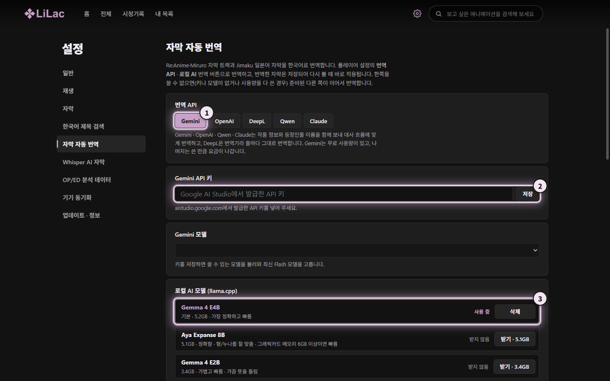
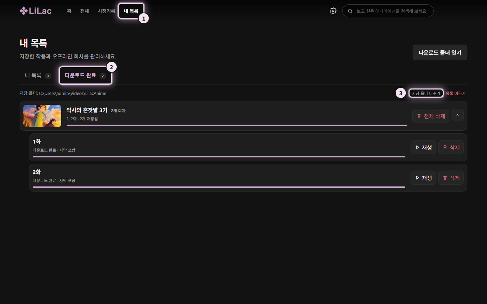
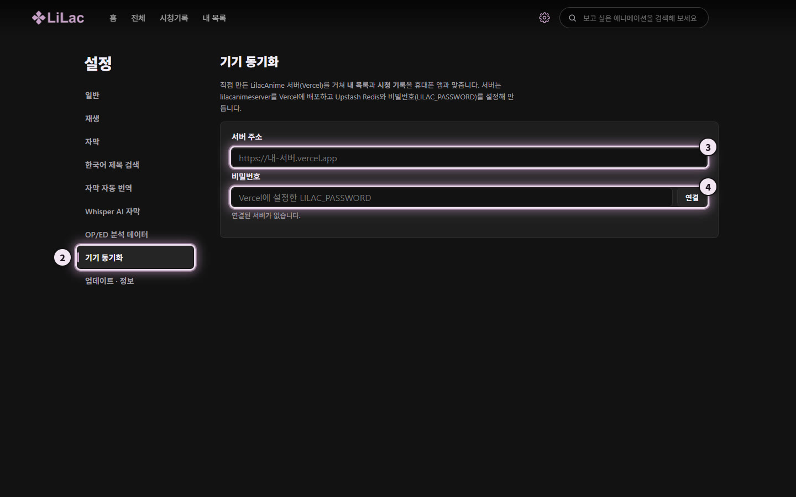

<p align="center">
  
</p>

<p align="center">
  <a href="https://github.com/whispelyn-byte/LilacAnime-desktop/releases/latest"></a>
  
  
  
</p>

<p align="center">
  <a href="https://github.com/dream150/LilacAnime">LilacAnime</a> Android 앱의 데스크톱판입니다.<br>
  여러 사이트의 애니를 한 화면에서 찾아 보고, 한국어 자막을 알아서 찾아 입히고,<br>
  없으면 일본어·영어 자막을 한국어로 번역해 줍니다. 회차를 내려받아 오프라인에서도 봅니다.
</p>

> [!IMPORTANT]
> **설치하고 가장 먼저 [TMDB 키](#tmdb-키-넣기)를 넣어 주세요.** 무료이고 5분이면 됩니다. 키가 있어야 영어 제목 사이트 작품의 한국어 제목을 찾고, 그래야 한국어 자막이 붙습니다.



## 주요 기능

- **여러 사이트를 한 곳에서:** RE:Anime · Miruro · Animenosub · 애니24 · 링크애니 · Linkkf. 영어 제목 작품도 한국어 제목으로 보여 주고 한국어로 검색합니다.
- **한국어 자막 자동:** 사이트의 한국어 트랙, Kairan · Csora · Anissia 자막을 알아서 입힙니다.
- **없으면 AI 번역:** 번역 API(Gemini · OpenAI · DeepL · Qwen · Claude)나 내 PC의 로컬 AI(Gemma 4 · Aya · Hy-MT2)로, 보고 있는 장면부터 번역합니다.
- **다운로드:** 자막 · OP/ED 구간까지 함께 저장해 오프라인에서도 그대로 봅니다.
- OP/ED 건너뛰기 · 이어보기 · 다음 화 자동 재생 · 휴대폰 동기화 · 키보드 단축키

## 설치

| 운영체제 | 받기 |
|---|---|
| Windows 10 / 11 | **[LilacAnime-Setup.exe](https://github.com/whispelyn-byte/LilacAnime-desktop/releases/latest/download/LilacAnime-Setup.exe)** |
| macOS | **[Apple Silicon](https://github.com/whispelyn-byte/LilacAnime-desktop/releases/latest/download/LilacAnime-mac-arm64.dmg)** · **[Intel](https://github.com/whispelyn-byte/LilacAnime-desktop/releases/latest/download/LilacAnime-mac-x64.dmg)** |
| Linux (.deb) | **[x64](https://github.com/whispelyn-byte/LilacAnime-desktop/releases/latest/download/LilacAnime-linux-amd64.deb)** · **[arm64](https://github.com/whispelyn-byte/LilacAnime-desktop/releases/latest/download/LilacAnime-linux-arm64.deb)** |

- **Windows:** 받은 파일을 실행해 설치합니다.
- **macOS:** `.dmg`를 열고 응용 프로그램 폴더로 끌어 놓습니다. 처음 열 때 "악성 코드가 없음을 확인할 수 없습니다"가 나오면 **완료** → **시스템 설정 > 개인정보 보호 및 보안 > 그래도 열기**를 누릅니다. 그래도 안 열리면 터미널에서 `xattr -cr /Applications/LilacAnime.app`을 실행합니다.
- **Linux (Ubuntu · Debian · Mint 등):** `sudo apt install ./LilacAnime-linux-amd64.deb`(arm64면 그 파일 이름)로 설치하면 앱 메뉴에 생깁니다. 지우려면 `sudo apt remove lilacanime-desktop`.

새 버전이 나오면 앱이 알려 주고, **설정 > 업데이트 · 정보**에서 바로 설치합니다.

## TMDB 키 넣기

**한국어 자막을 찾는 데 가장 중요한 설정입니다.** RE:Anime · Miruro · Animenosub는 제목이 영어라서, 한국어 자막을 찾으려면 그 작품의 한국어 제목을 알아야 합니다. TMDB 키가 있으면 훨씬 많은 작품의 한국어 제목을 찾고, 제목과 줄거리도 한국어로 나옵니다.

**1. TMDB에서 키 받기** (무료, PC 브라우저로 5분)

1. [themoviedb.org에 가입](https://www.themoviedb.org/signup)하고 메일로 온 링크를 눌러 인증합니다.
2. 로그인한 뒤 [설정 > API](https://www.themoviedb.org/settings/api)로 갑니다.
3. **Create / Request an API Key** → **Developer**를 고르고 약관에 동의합니다.
4. 신청서: 용도 개인(Personal), 앱 이름 `LilacAnime`, 주소는 아무 주소(예: 이 GitHub 주소), 설명 "개인용 애니 제목 검색".
5. 나온 **API 키**(32자)를 복사합니다. 아래의 긴 **읽기 액세스 토큰**도 됩니다.

**2. 앱에 넣기**



1. 오른쪽 위 **설정**(톱니바퀴)을 누릅니다.
2. 왼쪽에서 **한국어 제목 검색**을 고릅니다.
3. **TMDB API 키**에 붙여 넣고 **저장**을 누릅니다. "TMDB API 키를 사용 중입니다"가 나오면 성공입니다.
4. 아래 칸에서 한국어 제목을 찾아 갑니다. 처음엔 몇 분 걸리고, 그동안에도 앱은 그대로 쓸 수 있습니다.

<details>
<summary><b>잘 안 될 때</b></summary>

- **"저장하지 못했습니다" · "TMDB API 키나 사용 권한을 확인해 주세요":** 키를 앞뒤 공백 없이 다시 복사해 넣어 보세요. 읽기 액세스 토큰을 넣어도 됩니다.
- **"TMDB에 연결하지 못했어요" · "응답 시간이 초과됐어요":** 인터넷이나 TMDB 서버 문제입니다. 앱이 켜져 있으면 30분 뒤 다시 시도합니다.
- **"TMDB 요청 제한으로 잠시 쉬는 중":** 정상입니다. 잠시 뒤 이어서 찾습니다.
- **숫자가 전체 작품 수까지 안 올라가요:** 진행률이 아니라 한국어 제목을 찾은 작품 수입니다. 한국어 제목이 없는 작품도 있어 정상입니다.

</details>

## 사용법

### 애니 보기



1. 위쪽 검색창에 제목을 **한국어로** 입력하고 Enter를 누릅니다.
2. 또는 **이번 시즌 추천**에서 고릅니다. 작은 포스터는 그 작품으로 바꾸고, 큰 포스터는 작품 화면을 엽니다.
3. **전체 > 상세 필터**에서 장르 · 연도 · 상태 같은 조건으로 찾아봅니다.



1. **○화 재생**은 첫 화부터, 본 적이 있으면 **이어보기**로 멈춘 곳부터 재생합니다.
2. 보고 싶은 회차를 골라 눌러도 됩니다.
3. 회차 옆 버튼은 그 회차만 내려받습니다.
4. **전체 저장**은 모든 회차를 내려받습니다.

### 자막 고르기



1. 재생 화면 오른쪽 위 **플레이어 설정**을 누릅니다.
2. **자막** 탭을 엽니다.
3. **자막 가져올 곳:** 다른 블로그를 골라 보거나, 다른 회차 자막이 나오면 **AI 번역**을 누릅니다.
4. **자막 제작자 · 트랙:** 다른 분의 자막이나 사이트의 다른 언어 트랙으로 바꿉니다.
5. **한국어 자막 다시 찾기** · **내 PC의 자막 파일 열기**(ASS · SSA · SRT · VTT · SMI)

### 자막 크기 · 싱크 · 글꼴



1. 플레이어 설정에서 **자막 모양** 탭을 엽니다.
2. **크기 · 줄 간격 · 높이:** 막대를 끌어 바꿉니다.
3. **타이밍:** 자막이 늦으면 **빠르게**, 먼저 나오면 **늦게**. 보면서 **Z** · **X** 키로도 바꿉니다. 어긋나면 앱이 음성에 맞춰 자동으로 맞추기도 합니다.
4. **글꼴:** 내 PC의 글꼴 파일(TTF · OTF)을 고릅니다.

### 번역 시작하기

한국어 자막이 없는 작품도 보려면 둘 중 하나만 준비하면 됩니다.



1. **번역 API (추천: Gemini, 무료):** 설정 > **자막 자동 번역**에서 **Gemini**를 고릅니다.
2. [Google AI Studio](https://aistudio.google.com/apikey)에서 **Create API key**로 만든 키를 붙여 넣고 **저장**합니다.
3. **로컬 AI (인터넷 없이):** **Gemma 4 E4B**의 **받기**를 누릅니다(5.2GB).

준비가 되면 한국어 자막이 없는 회차를 열기만 하면 됩니다. 몇 초 뒤 대사가 한국어로 바뀝니다.

### 오프라인으로 보기



1. 위쪽 **내 목록**을 누릅니다.
2. **다운로드 완료** 탭에 받은 회차가 작품별로 모여 있습니다.
3. **저장 폴더 바꾸기:** 파일을 외장하드로 옮겼다면 옮긴 폴더를 고르면 다시 이어집니다.

### 휴대폰과 동기화



1. [LilacAnime 서버](https://github.com/whispelyn-byte/LilacAnime-server)를 내 Vercel에 배포하고 Upstash Redis를 연결한 뒤 `LILAC_PASSWORD`(8자 이상)를 정합니다. 한 번만 하면 됩니다.
2. 설정 > **기기 동기화**를 엽니다.
3. **서버 주소**에 배포한 주소를 넣습니다.
4. **비밀번호**를 넣고 **연결**을 누릅니다. 휴대폰 앱에도 같은 주소와 비밀번호를 넣습니다.

## 더 알아보기

콘텐츠 소스별 차이, 자막 · 번역 동작, 플레이어 단축키, 문제 해결, 저장 위치는 **[자세한 설명](docs/GUIDE.md)** 에 있습니다.

## 개발

```powershell
npm install
npm start
npm run dist        # Windows 설치 파일 (dist:mac → .dmg, dist:linux → .deb)
```

`v`로 시작하는 태그를 올리면 GitHub Actions가 모든 운영체제용 파일을 만들어 릴리즈 초안에 올립니다. 폴더: `electron/`(메인 프로세스) · `src/`(화면) · `scripts/`(빌드 보조).

## 크레딧

- 원작: [dream150/LilacAnime](https://github.com/dream150/LilacAnime) (Android). 원작자의 허락을 받아 데스크톱용으로 포팅했습니다.
- 자막: Kairan, Csora, [Anissia](https://anissia.net)의 자막 제작자분들, [Jimaku](https://jimaku.cc)
- 로컬 번역: [llama.cpp](https://github.com/ggml-org/llama.cpp), [Gemma 4](https://huggingface.co/google/gemma-4-E4B-it-qat-q4_0-gguf), [Aya Expanse](https://huggingface.co/CohereLabs/aya-expanse-8b), [Tencent Hy-MT2](https://github.com/Tencent-Hunyuan/Hy-MT2)
- OP/ED 타임스탬프: [AniSkip](https://aniskip.com)
- This product uses the TMDB API but is not endorsed or certified by TMDB.
